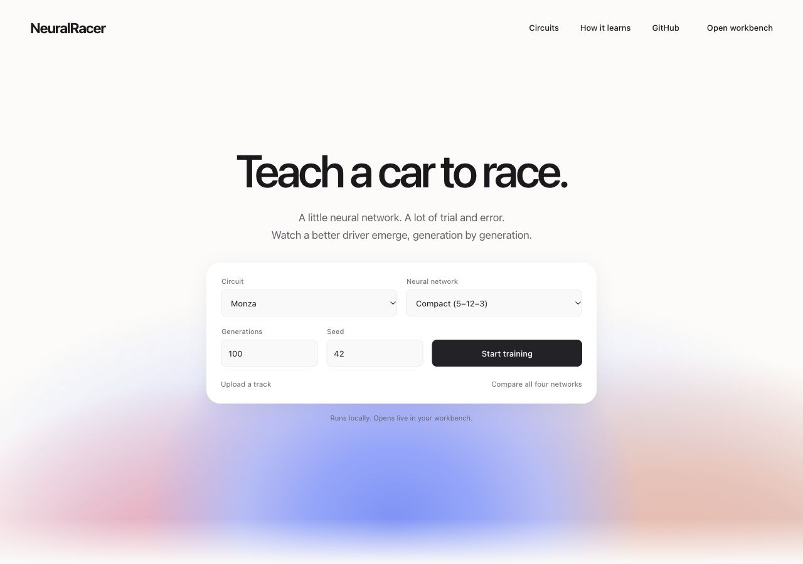

# Neural Racer

A local Python simulator where neural networks learn to drive faster laps, with a React homepage and a live training workbench.

## Run locally

Install Python 3.12 to 3.14, uv, and Node.js 24 or newer. Open Terminal and run these commands.

```text
git clone https://github.com/landfvit/neural-racer.git
cd neural-racer
uv sync --locked
npm --prefix frontend ci
npm --prefix frontend run build
uv run uvicorn app:app --host 127.0.0.1 --port 8002
```

Open [localhost:8002](http://127.0.0.1:8002/). Choose a circuit, network, generation limit, and seed, then click **Start training**. **Compare all four networks** launches a comparison on the selected circuit. **Upload a track** accepts your own PNG or JPEG using the requirements below. Each launch creates a fresh run and opens the workbench.

Click **Open workbench** to view an existing run without restarting it, or go directly to [localhost:8002/workbench](http://127.0.0.1:8002/workbench). Python handles the simulation and training. Without a frontend build, the root address opens the workbench directly.

Closing the Terminal session stops the server. Run tests with these commands.

```text
uv run --extra dev pytest -q
npm --prefix frontend test
```

For React development, keep the Python server running on port 8002. Open another Terminal and run `npm --prefix frontend run dev`. The development page is at [localhost:5174/static/site/](http://127.0.0.1:5174/static/site/).

## Use the workbench

Choose a circuit and network, then click **Train**. Translucent ghost cars show the population around an opaque leader. **Pause** freezes training. The speed selector accelerates simulation, while lap times stay in simulation seconds. **Rays** toggles sensor drawing. Sensing always remains active.

**Network** opens the leader's layers and activations in a separate window. Hover over nodes for details. Click **Close** or press Escape to return to the track.

**Compare networks** starts all four architectures on the same track with 64 cars and the chosen seed and generation limit. The network selector changes inspection. **Single network** starts fresh training of the selected architecture with ghost cars. **Reset**, track changes, and changing networks outside comparison create a fresh paused run.

**Generations** sets the training budget. Increase it to keep learning without losing progress. After a completed run, increase it and click **Train** to continue. **Seed** controls the random mutations. Changing it starts a fresh paused run. Both settings apply to single training and comparisons. Defaults are 100 generations and seed 42.

## How it learns

Each car has its own neural network. Weights and biases start at zero, so generation 0 stays still. Mutations create varied driving attempts from generation 1 onward.

Ordered checkpoints measure progress and fitness. A completed lap beats every incomplete attempt, then shorter times score higher. Collisions and stalling end attempts.

The strongest networks survive each generation. Other cars inherit mixed copies with random mutations. This evolutionary selection develops driving behavior and faster laps. The fixed seed makes fresh runs repeatable.

Five wall distances enter the network. Rays point 60 and 30 degrees left, straight ahead, and 30 and 60 degrees right. Inputs range from 0 to 1. Smaller values mean a nearby boundary. A value of 1 means clear space to maximum sensor range.

Outputs request steering, target speed, and braking. Physics applies acceleration or braking toward that speed. Explicit braking takes priority. Faster cars turn wider, so braking helps with tight corners.

| Network | Layers |
| --- | --- |
| Compact | 5 → 12 → 3 |
| Wide | 5 → 24 → 3 |
| Deep | 5 → 16 → 12 → 3 |
| Split steering | 5 → 20 → 12 → 4 |

Split steering uses separate left and right steering outputs.

Purple shows each generation's best fitness. Higher is better. Green shows its fastest lap. Lower is better, and gaps mean nobody finished. **Best** retains the lap record. Comparison curves show each network's best lap so far.

## Upload your track

Draw one wide, solid closed road on a contrasting background, with empty space around it. Avoid intersections, branches, markings, text, and textures. For a 960 by 640 image, start with a road at least 40 pixels wide.

Click **Upload track** or drop a static PNG or JPEG onto the track pane. The limit is 8 MiB and 8 million pixels, with both sides at least 64 pixels. Images fit within 960 by 640. Road detection, start position, and direction are automatic.

A successful upload starts a fresh paused run. Click **Train**. If detection fails, simplify the image and widen the road. The circuit selector restores built-in tracks.

## Save a model

**Save brain** exports the inspected network's best policy as JSON after a completed generation. Reloading models uses Python's `racer.models.load_model` and `Trainer.load_model`. Restarting the server clears training from memory.

Built-in circuits are widened F1-inspired approximations. Lap times are simulator comparisons, with elevation and banking omitted. Attribution is in [NOTICE](NOTICE).

## Screenshots

Choose a circuit and configure a fresh run on the homepage.



The workbench shows the track, ghost cars, wall rays, and learning history.


Four leaders in comparison mode. Blue is Compact, orange is Wide, green is Deep, and pink is Split steering.


Open **Network** to inspect the leader. Purple connections are positive and pink are negative. Stronger connections appear darker and thicker.


